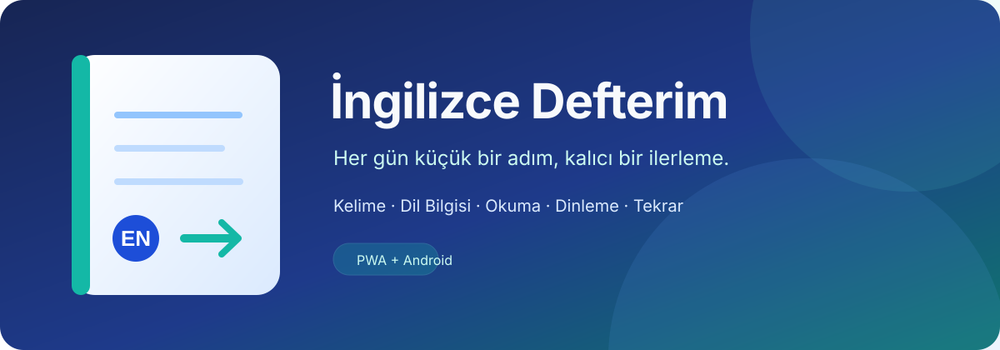
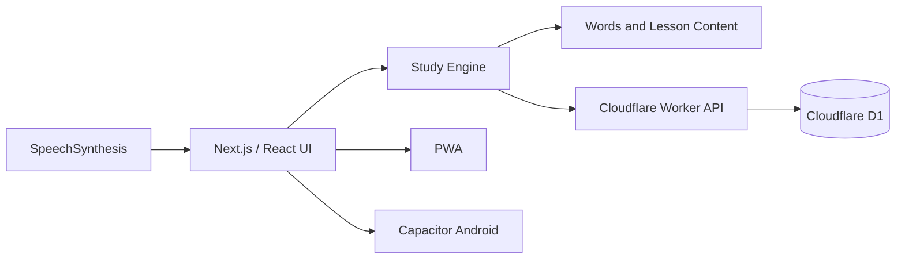

<p align="center">
  
</p>

<p align="center">
  <strong>Kelime, dil bilgisi, okuma ve alıştırmayı tek günlük çalışma akışında birleştiren kişisel İngilizce uygulaması.</strong>
</p>

<p align="center">
  
  
  
  
  
  
</p>

## Proje özeti

**İngilizce Defterim**, ezber listesinden fazlasını sunan kişisel bir çalışma uygulamasıdır. Kelime tekrarı, Türkçe anlatımlı dil bilgisi, fiil biçimleri, okuma parçaları, dinleme ve farklı soru türlerini günlük ve takip edilebilir bir akışta bir araya getirir.

Uygulama web üzerinde kurulabilir bir PWA'dır; aynı içerik Capacitor ile Android uygulamasına da paketlenebilir.

## İçerik

| Bölüm | Kapsam |
|---|---:|
| Kelime kayıtları | 5.946 |
| Farklı yazılış | 4.961 |
| Ders | 39 |
| Ders örneği | 376 |
| Fiil | 60 |
| Okuma ve diyalog | 4 |
| Alıştırma | 205 |

## Özellikler

- Her gün **10 kelime + 1 konu + 3 soru** öneren çalışma planı
- Zorlanılan kelimeleri önceleyen aralıklı tekrar akışı
- 12 zaman, yardımcı fiiller, temel dil bilgisi ve sık karıştırılan kelimeler
- Cümle yazma, boşluk doldurma, fiil biçimi, kelime sıralama ve dönüşüm soruları
- İngiliz ve Amerikan telaffuzu için tarayıcı tabanlı seslendirme
- Son 7 günlük çalışma, yanlışlar ve tamamlanan dersler için ilerleme takibi
- Aynı işlemin iki kez sayılmasını engelleyen idempotent kayıt sistemi
- PWA kurulumu ve Capacitor tabanlı Android paketleme

## Tekrar yaklaşımı

Yanıta göre tekrar aralığı anlaşılır bir kuralla ilerler:

- **Tekrar edelim:** 10 dakika
- **Zorlandım:** 1 gün
- **Hatırladım:** 1 → 3 → 7 → 14 → 30 → 60 gün

Bu mekanizma kişisel çalışma düzeni sunar; bilimsel olarak kişiye özel optimize edilmiş bir öğrenme garantisi iddia etmez.

## Mimari



```text
ingilizce-defterim/
├── app/                 # Sayfalar ve stiller
├── components/          # Çalışma ekranları ve UI bileşenleri
├── content/             # Ders, fiil, okuma ve alıştırma verileri
├── db/                  # D1/Drizzle şeması
├── drizzle/             # Veritabanı migration'ı
├── public/              # PWA manifesti, service worker ve kelime verisi
├── tests/               # Çalışma motoru ve API kontrolleri
└── android/             # Capacitor Android projesi
```

## Yerel geliştirme

Gereksinim: **Node.js 22.13 veya üzeri**

```bash
npm run install:ci
npm run dev
```

Kalite kontrolleri:

```bash
npm run lint
node --experimental-strip-types --test tests/study.test.mjs
npm run build
```

Android debug APK:

```bash
npm run android:apk
```

## Gizlilik ve kapsam

- İlerleme ve yanlışlar kullanıcı kimliğine göre D1 üzerinde saklanır.
- Mobil sürümde ilerleme cihazda kalır ve web hesabıyla eşitlenmez.
- `localStorage` yalnızca cihazın dinleme tercihi için kullanılır.
- Açık uçlu cevaplar yapay zekâ tarafından puanlanmaz; kullanıcı alternatif cevabını kendisi değerlendirebilir.
- Seslendirme cihazın `SpeechSynthesis` desteğine bağlıdır; insan ses kaydı veya konuşma puanlama yoktur.
- Kelime verisi, kullanıcı tarafından sağlanan KelimeLog içeriğinden düzenlenmiştir; resmî Oxford listesinin eksiksizliği iddia edilmez.

Güvenlik bildirimleri için [`SECURITY.md`](SECURITY.md) dosyasını inceleyin.
